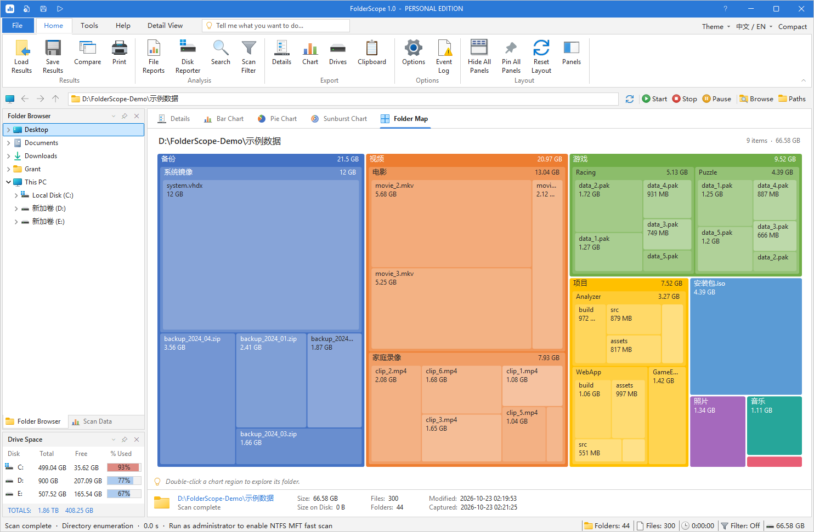
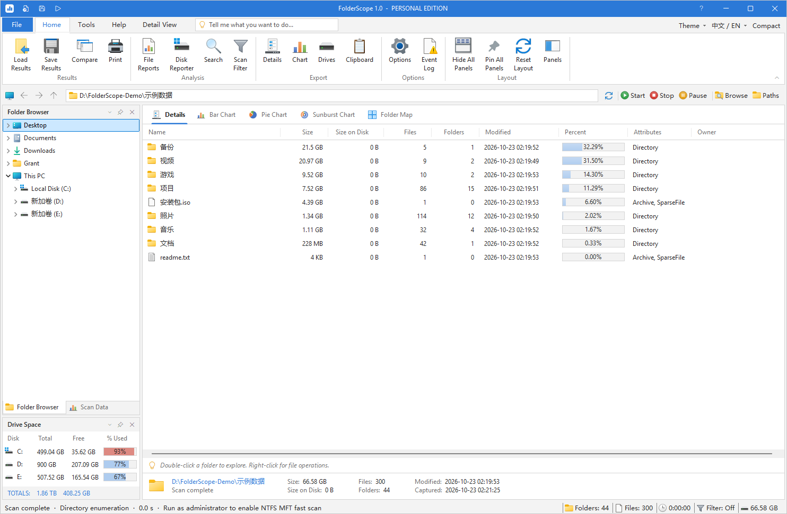

# FolderScope

**A fast disk space analyzer for Windows — see exactly what is filling your drives.**

[](https://github.com/grantyxy/FolderScope/actions/workflows/build.yml)
[](https://github.com/grantyxy/FolderScope/releases/latest)
[](LICENSE)

[简体中文](README.md)

FolderScope scans an entire drive in seconds, ranks every folder and file by size, visualizes the result as a treemap, sunburst and other charts, and ships 17 file reports for large, old, duplicate and temporary files. The interface is available in English and Simplified Chinese and can be switched at any time.



## Highlights

- **Fast scanning** — multi-threaded directory enumeration that reads hundreds of entries per system call and never opens individual files. When run as administrator, FolderScope reads the NTFS Master File Table (MFT) directly, which is even faster on large drives.
- **Clear visuals** — details grid, bar chart, donut chart, sunburst and folder map. Double-click any region to drill into that folder.
- **Find what to clean up** — 17 reports including largest files, oldest files, temporary files, empty folders, long paths and duplicate files (with optional SHA-256 content comparison).
- **Familiar workflow** — Office-style ribbon, Explorer file icons and a context menu to open, locate, copy, move, recycle or zip items.
- **Track changes** — save scan snapshots, browse them offline and compare two scans to see which folders grew.
- **Export and automate** — XLSX, CSV, HTML, PDF, XML and TXT reports, command-line scans, and scheduled reports with e-mail delivery through Windows Task Scheduler.



## Download and run

1. Download `FolderScope-v1.0.0-win-x64.zip` from [Releases](https://github.com/grantyxy/FolderScope/releases/latest).
2. Extract it anywhere and run `FolderScope.exe`. Keep `FolderScope.exe.config` next to it.
3. Pick a drive or folder to scan. Use **中文 / EN** in the top-right corner to change the language.

**Requirements:** Windows 10 / 11 (x64) with .NET Framework 4.8 (included in Windows 10 version 1903 and later). Portable — no installer, no registry entries.

## Scan engines

| Engine | Used when | Notes |
| --- | --- | --- |
| NTFS MFT direct read | Running as administrator on a local NTFS drive | Reads the whole Master File Table sequentially and rebuilds the tree in memory; also sees system folders that normal accounts cannot list |
| Parallel directory enumeration | Everything else (standard user, network paths, exFAT / FAT32, …) | Multi-threaded traversal, no elevation required |

The engine is chosen automatically and the status bar shows which one was used and how long the scan took. Use **Tools → Run as Admin** to enable MFT mode, or turn it off under **Options → Scanning**.

## Command line

```text
FolderScope.exe --scan "D:\Data" --snapshot "D:\Reports\scan.fsscan" --export "D:\Reports\details.xlsx"
FolderScope.exe --scan "D:\Data|E:\Data" --report "Largest Files" --export "D:\Reports\large.csv"
FolderScope.exe --scan "D:\Data" --report "Duplicate Files" --duplicate-mode "Content (SHA-256)" --export "D:\Reports\duplicates.html"
FolderScope.exe --benchmark C:\
```

- Separate multiple paths with `|`. Report names are English identifiers such as `Largest Files`, `File Types` and `Duplicate Files`.
- Exit codes: `0` finished, `1` error, `3` cancelled. Skipped or inaccessible items are listed in an adjacent `.events.txt` file.
- `--benchmark` scans the path with both engines and writes a timing and result comparison.

## Build from source

Only the .NET Framework compiler that ships with Windows is needed — no Visual Studio or NuGet:

```powershell
powershell -NoProfile -ExecutionPolicy Bypass -File .\build.ps1
```

The build writes `FolderScope.exe` to the repository root; sources live in `src/`. Run the built-in self-test with:

```powershell
$dir = Join-Path $env:TEMP 'FolderScope-tests'
Start-Process .\FolderScope.exe -ArgumentList '--self-test', "`"$dir`"" -Wait
Get-Content (Join-Path $dir 'test-results.txt')
```

## Notes

- Settings, disk history and logs are stored in `%LOCALAPPDATA%\FolderScope`; delete that folder to reset.
- Size totals are not identical to physical disk usage: hard links, compressed / sparse files and file-system metadata all play a role.
- Snapshots (`.fsscan`) use FolderScope's own format. PDF exports are rendered as images; export XLSX or CSV when you need full, selectable paths.
- Delete moves items to the Recycle Bin. Before files are moved or renamed, FolderScope checks that they have not changed since the scan.

## License

[MIT](LICENSE)
