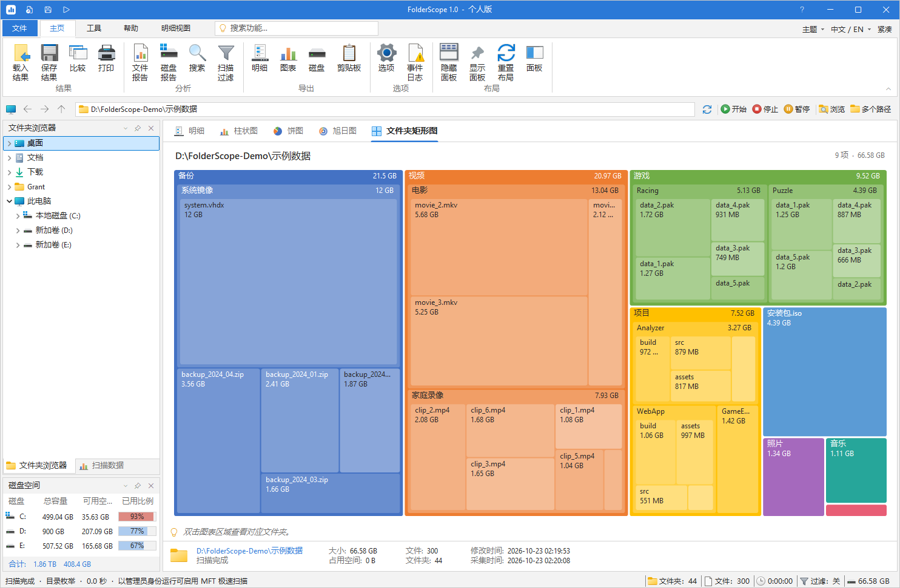
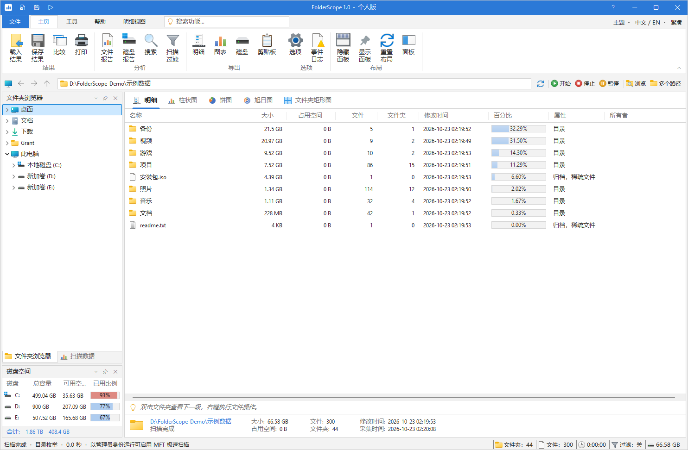
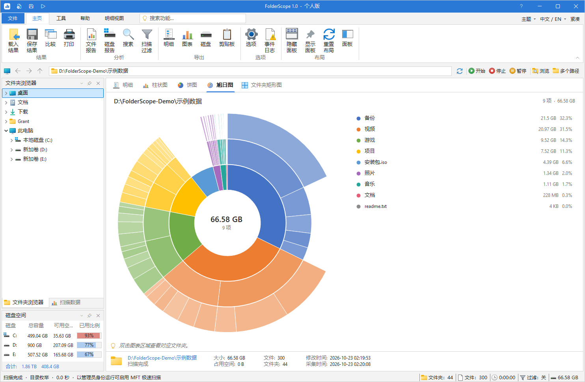
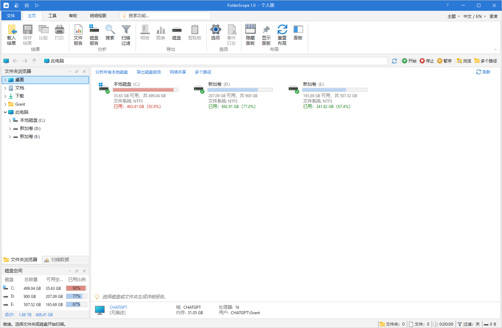
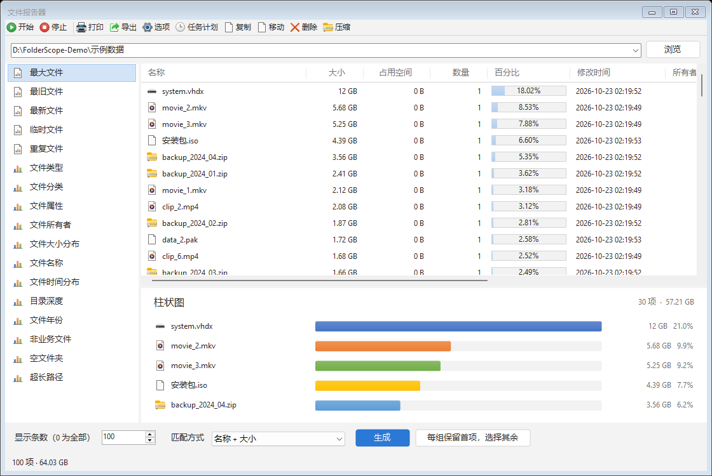

# FolderScope

**Windows 磁盘空间分析工具：快速找出空间被什么占用。**

[](https://github.com/grantyxy/FolderScope/actions/workflows/build.yml)
[](https://github.com/grantyxy/FolderScope/releases/latest)
[](LICENSE)

[English](README.en.md)

FolderScope 能在几秒内扫描整块磁盘，按大小列出每个文件夹和文件，用矩形树图、旭日图等图表直观展示空间分布，并提供大文件、重复文件、文件类型等 17 类报告。界面支持简体中文和英文，随时切换。



## 亮点

- **扫描快**：多线程目录枚举，一次系统调用读取上百个条目，不逐个打开文件；以管理员身份运行时直接读取 NTFS 主文件表（MFT），大容量磁盘更快。
- **一眼看懂**：明细表、柱状图、环形饼图、旭日图、文件夹矩形图五种视图，双击任意区域即可进入对应文件夹。
- **找到该删的文件**：最大文件、最旧文件、临时文件、空文件夹、超长路径、按内容（SHA-256）比对的重复文件等 17 类报告。
- **熟悉的操作**：Office 风格功能区、资源管理器同款文件图标、右键直接打开 / 定位 / 复制 / 移动 / 移入回收站 / 压缩。
- **可以留存和对比**：保存扫描快照，离线查看，对比两次扫描找出增长最快的目录。
- **导出与自动化**：XLSX、CSV、HTML、PDF、XML、TXT 报告；命令行扫描；配合 Windows 计划任务定期生成报告并发送邮件。

## 截图

| 扫描明细 | 旭日图 |
| --- | --- |
|  |  |
| **此电脑** | **文件报告** |
|  |  |

## 下载与运行

1. 在 [Releases](https://github.com/grantyxy/FolderScope/releases/latest) 下载 `FolderScope-v1.0.0-win-x64.zip`。
2. 解压到任意目录，双击 `FolderScope.exe`。请保留同目录下的 `FolderScope.exe.config`。
3. 选择一个磁盘或文件夹开始扫描；右上角 **中文 / EN** 可切换界面语言。

**系统要求**：Windows 10 / 11（x64），.NET Framework 4.8（Windows 10 1903 及以上已自带）。绿色免安装，不写注册表。

## 两种扫描方式

| 方式 | 何时使用 | 说明 |
| --- | --- | --- |
| NTFS MFT 直读 | 以管理员身份运行，扫描本地 NTFS 磁盘 | 顺序读取整张主文件表并在内存中重建目录树，能看到普通权限无法进入的系统目录 |
| 并行目录枚举 | 其他所有情况（普通权限、网络路径、exFAT / FAT32 等） | 多线程遍历目录，无需管理员权限 |

程序会自动选择，扫描结束后状态栏显示实际使用的方式和耗时。需要 MFT 模式时，可点击功能区 **工具 → 管理员运行**；也可以在 **选项 → 扫描** 中关闭 MFT 直读。

## 命令行

```text
FolderScope.exe --scan "D:\Data" --snapshot "D:\Reports\scan.fsscan" --export "D:\Reports\details.xlsx"
FolderScope.exe --scan "D:\Data|E:\Data" --report "Largest Files" --export "D:\Reports\large.csv"
FolderScope.exe --scan "D:\Data" --report "Duplicate Files" --duplicate-mode "Content (SHA-256)" --export "D:\Reports\duplicates.html"
FolderScope.exe --benchmark C:\
```

- 多个路径用 `|` 分隔；报告名称使用英文标识（如 `Largest Files`、`File Types`、`Duplicate Files`）。
- 退出码：`0` 完成、`1` 出错、`3` 已取消。被跳过或无权访问的项目会写入同名的 `.events.txt`。
- `--benchmark` 会分别用两种扫描方式扫描指定路径，并生成耗时和结果对比报告。

## 从源码构建

只需要 Windows 自带的 .NET Framework 编译器，不依赖 Visual Studio 或 NuGet：

```powershell
powershell -NoProfile -ExecutionPolicy Bypass -File .\build.ps1
```

编译结果为仓库根目录下的 `FolderScope.exe`，源码位于 `src/`。运行内置自检：

```powershell
$dir = Join-Path $env:TEMP 'FolderScope-tests'
Start-Process .\FolderScope.exe -ArgumentList '--self-test', "`"$dir`"" -Wait
Get-Content (Join-Path $dir 'test-results.txt')
```

## 说明

- 设置、磁盘历史和日志保存在 `%LOCALAPPDATA%\FolderScope`，删除该目录即可恢复默认。
- 文件大小合计不完全等于磁盘实际占用：硬链接、压缩 / 稀疏文件和文件系统元数据都会带来差异。
- 快照文件（`.fsscan`）为 FolderScope 自有格式。PDF 导出为图片页面，需要可复制的完整路径时请导出 XLSX 或 CSV。
- 删除操作默认移入回收站；移动、重命名前会检查文件在扫描后是否发生变化。

## 许可证

[MIT](LICENSE)
